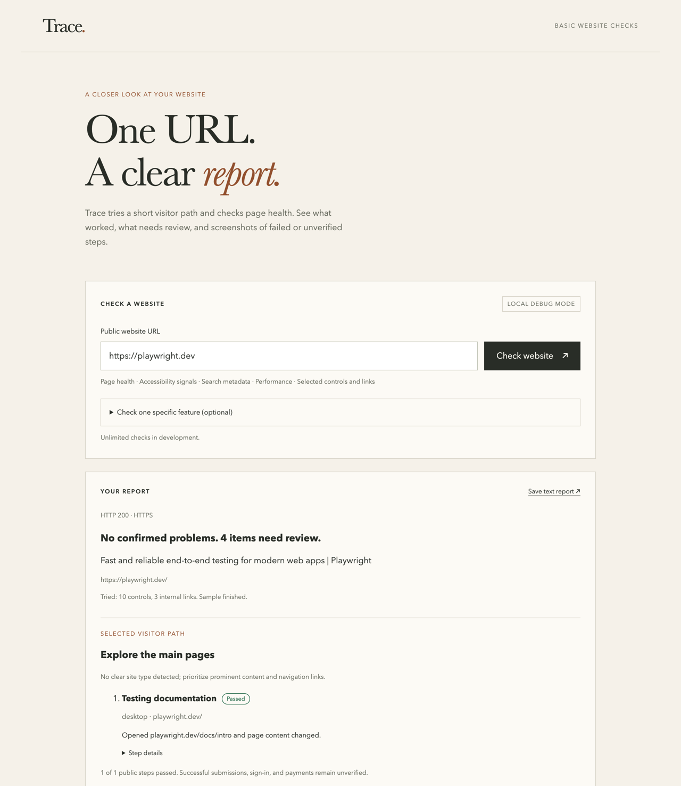

# Trace

You paste in a URL and Trace opens the site in a real browser, clicks around a bit like a visitor would, and gives you back a short report on what worked and what didn't.

I built it because most site checkers only load the homepage and score it. I wanted something that actually tries the menu, follows a couple of links, types into a form, and shows a screenshot when something doesn't behave.



## What it checks

- **Page health:** status codes, HTTPS, broken images, JS errors on load, mobile overflow, and some security headers.
- **Accessibility:** missing labels and alt text, unnamed buttons, tab order, and a sample of text contrast.
- **Search preview:** title, description, H1, and noindex.
- **Performance:** LCP, layout shift, and long tasks from one visit. This isn't real-user data.
- **Visitor path:** it guesses what a visitor would want on the site and tries that. On a gym site that's locations, on a shop it's products. On each page it presses up to four buttons, edits up to two forms, and follows up to three links. Anything that fails or can't be confirmed gets a screenshot with the element marked in red.

You can also give it one thing to check yourself, like "click *Show hours* and expect to see *Open until 5 PM*".

The report splits findings into real problems, things to review, and recommendations. It won't call something broken unless it actually saw it break.

## Staying safe on other people's sites

Trace visits sites it doesn't control, so I locked down what it's allowed to do:

- **Forms never submit.** It types into fields and checks the validation, but every outgoing request is blocked while it does. Password, card, and file fields are skipped.
- **Searches are limited.** A search box can only send the word `trace`, and only to its own site.
- **Only reads go out.** POST/PUT requests, WebSockets, downloads, and popups are blocked.
- **No private addresses.** Every request goes through a small proxy (`src/outbound-proxy.ts`) that rejects private, loopback, and cloud metadata addresses. It also pins the IP it checked, so DNS rebinding can't sneak past.
- **Each check is short-lived.** It gets a fresh browser and a 90 second deadline, and only one runs at a time.
- **Usage is capped.** Each IP gets 3 checks a day. IPs are stored as salted hashes, never raw.

Still, only run it on sites you're allowed to test.

## Running it

You need Node 22+.

```sh
npm install
npx playwright install chromium
npm run dev
```

Then open http://127.0.0.1:3120. If you'd rather use your installed Chrome, run `TRACE_BROWSER_CHANNEL=chrome npm run dev`.

The server only listens on localhost.

```sh
npm run check   # type check
npm test        # unit + browser tests
TRACE_BROWSER_CHANNEL=chrome TRACE_LIVE_TESTS=1 npm test   # also hits example.com and playwright.dev
```

## Code layout

- `src/basic-check.ts` runs a check from start to finish.
- `src/explore.ts` and `src/journey.ts` pick the visitor path and try the buttons and links.
- `src/form-interactions.ts` and `src/search-interactions.ts` handle the form and search tests.
- `src/checks.ts` holds the page health, accessibility, metadata, and performance checks.
- `src/report.ts` turns the results into the report.
- `src/screenshot-evidence.ts` takes the marked-up screenshots.
- `src/network-policy.ts` and `src/outbound-proxy.ts` decide what the browser is allowed to reach.
- `src/daily-quota.ts` is the 3-per-day limit.
- `web/` is the plain HTML/JS frontend, and `tests/` has the tests.

There's more detail in [docs/how-it-works.md](docs/how-it-works.md).

## Not live yet

Right now it only runs locally. My portfolio's Trace page talks to it on localhost too, so it won't run checks on the live site until this is hosted. To host it for real, I'll run each check in its own locked-down container on a separate server. That plan is in [docs/DEPLOYMENT.md](docs/DEPLOYMENT.md), along with the `deployment/` and `src/gateway*` files. None of it is running yet.
